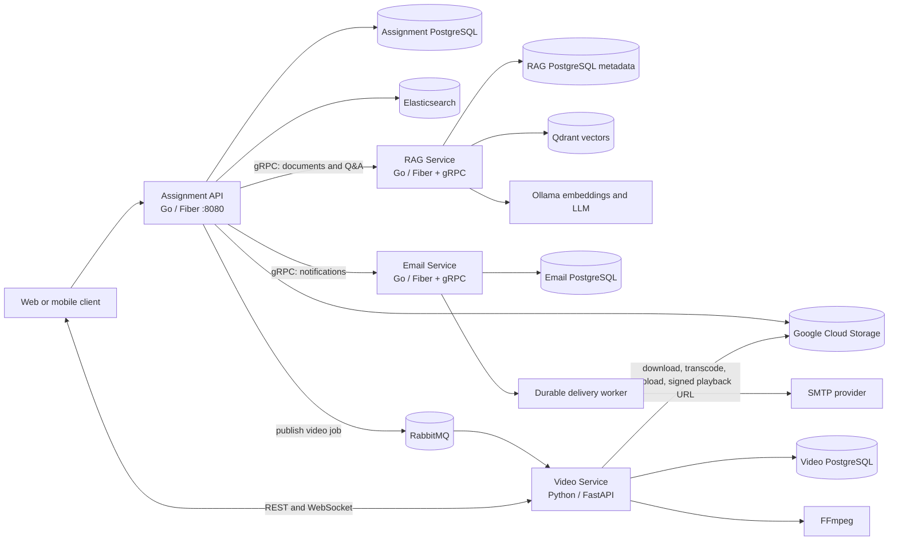

# 🎓 Assignment Portal - Microservices Documentation

> **Current documentation:** use the [service documentation index](docs/README.md) for live API routes, OpenAPI/Swagger links, database schemas, configuration, and run/test commands. Endpoint examples later in this legacy overview may refer to routes that have changed.


This repository contains a comprehensive assignment management system built with **microservices architecture**. The system consists of three main microservices that work together to provide assignment management, RAG-based assistance, and email notification capabilities.

## Architecture at a glance



The Assignment API is the authenticated business API for tenant, course, assignment, submission, and grading workflows. It owns its relational data and coordinates document assistance and notifications synchronously over gRPC. Video processing is queued so FFmpeg work can run independently from the upload request. The Video service also exposes its own REST and WebSocket endpoints for video and chat features.

The services use separate PostgreSQL schemas/databases and own their respective records. The Assignment API additionally integrates with GCS, Elasticsearch, RabbitMQ, RAG, and Email. RAG uses PostgreSQL for document metadata and chunk text while Qdrant stores vector points. Email keeps a durable delivery queue and event history in PostgreSQL. Video keeps its own video and chat records in PostgreSQL and media objects in GCS.

## Main business flows

### Tenant onboarding and assignments

1. An organization is created through `POST /tenants`; an owner invitation is sent.
2. The owner accepts the invitation and becomes the first tenant administrator. Administrators invite members and create courses.
3. An administrator creates assignments, optionally scoped to enrolled learners in a course, and the Assignment API stores assignment/submission records in PostgreSQL.
4. Learners use the dashboard and assignment routes to see work and upload submissions. The API applies tenant, role, due-date, resubmission, and upload rules.
5. Administrators review submissions, assign grades or rubric scores, and provide feedback. Learners can inspect grades and archived revisions.
6. Assignment and invitation notifications are sent to the Email service over gRPC.

### Document assistance (RAG)

1. An authenticated administrator uploads course material through the Assignment API.
2. The API checks file size, allowed type and signature, and malware scan result; it retains the clean source in GCS.
3. The API sends the document bytes and tenant metadata to RAG using the `UploadFile` gRPC method.
4. RAG splits text into overlapping chunks, requests embeddings from Ollama, stores document/chunk metadata in PostgreSQL, and upserts vectors and tenant/document payloads into Qdrant.
5. A learner asks a question through the Assignment API. RAG embeds the query, searches Qdrant with tenant filtering, builds context from matching chunks, and asks the configured Ollama model to generate an answer. The HTTP RAG API can also return source references.

### Video processing and playback

1. The Assignment API creates a tenant-scoped video record and a presigned GCS upload URL. Its aid service coordinates video indexing in Elasticsearch and publishes a processing job to RabbitMQ.
2. The Video service consumes the queued video ID, downloads the source from GCS, runs FFmpeg to create HLS playlists and segments, uploads the output, and updates processing status in its PostgreSQL database.
3. The Video service returns signed playback URLs and provides course/lesson, enrollment, transcript, progress, and chat endpoints.

The current repository has distinct video-related data models in the Assignment API and Video service. Check the service docs/schema before assuming their IDs or database schemas are interchangeable.

### Email delivery

1. The Assignment API calls Email's `SendAssignmentNotification` gRPC method.
2. Email validates the sender and request, then persists one queue record per recipient and returns without waiting for SMTP.
3. A background worker claims due messages, sends them through SMTP, records each attempt, and schedules transient failures with exponential backoff.
4. Authenticated Email REST endpoints expose sender identities, templates, delivery history, retries, and analytics.

## Services and code navigation

### Assignment API — `Assignment-api/assignment-portal/`

**Role:** primary product API and coordinator for tenant, course, assignment, submission, grading, document assistance, and video upload workflows.

- `main.go` — loads configuration, connects PostgreSQL/GCS/Elasticsearch, wires dependencies, registers middleware and routes, starts Fiber.
- `routes/routes.go` — endpoint map and public/admin/learner middleware boundaries.
- `controllers/` — HTTP request parsing and response handling.
- `services/` — business rules: `assignment_service.go`, `tenant_service.go`, `aid_service.go`, `user_service.go`, `file_service.go`, and `email_service.go`.
- `repositories/` and `database/` — SQL persistence plus Redis, RabbitMQ, Elasticsearch, and PostgreSQL setup.
- `models/`, `dto/` — persistence models and API request/response types.
- `middlewares/`, `utils/` — JWT validation, tenant context, observability, and shared helpers.
- `proto/` — generated gRPC clients for RAG and Email.
- `docs/` and `OPERATIONS.md` — API/schema details and operational behavior.

### RAG Service — `RAG-service/`

**Role:** tenant-aware document ingestion and retrieval-augmented question answering.

- `main.go` — dependency injection, HTTP/gRPC listeners, tracing, middleware, and graceful shutdown.
- `routes/`, `controllers/` — REST and gRPC entry points.
- `services/rag_service.go` — ingestion, metadata/vector persistence, semantic retrieval, and answer generation.
- `services/chunker.go`, `services/ai_client.go` — text chunking and Ollama HTTP integration.
- `repositories/` — Qdrant vector operations and PostgreSQL metadata/chunk persistence.
- `models/`, `dto/`, `apperrors/`, `middlewares/` — domain types, transport types, error mapping, and HTTP support.
- `proto/` — generated gRPC server definitions; source contracts also exist in the root `proto/` directory.

### Email Microservice — `email-microservice/`

**Role:** authenticated email administration and durable notification delivery.

- `main.go` — configuration, PostgreSQL connection, dependency wiring, background queue worker, HTTP and gRPC servers.
- `internal/route/` — REST route registration under `/api/v1`.
- `internal/handler/` — HTTP request handlers.
- `internal/grpc/handler/` — internal Assignment API notification endpoint.
- `internal/service/` — authentication, sender identity, templates, email queue/SMTP delivery, and analytics.
- `internal/repository/`, `internal/storage/` — repository contracts/implementations and PostgreSQL setup.
- `internal/domain/`, `internal/dto/`, `internal/config/`, `internal/middleware/` — entities, API types, configuration, and JWT middleware.
- `proto/` — generated gRPC definitions.

### Video Service — `video-service/`

**Role:** video catalog/playback, background video processing, and real-time chat.

- `app/app.py` — FastAPI app, lifespan setup, database connection, optional RabbitMQ consumer, tracing, routers, and error handling.
- `app/routes/routes.py` — video, course, lesson, enrollment, progress, transcript, and playback HTTP routes.
- `app/controllers/controllers.py` — FFmpeg processing pipeline and GCS input/output.
- `app/controllers/chatcontrollers.py` — WebSocket chat, persisted history, broadcast, and admin actions.
- `app/database/` — PostgreSQL connection and RabbitMQ consumer.
- `app/repositories/` — video and chat data access.
- `app/schemas/`, `app/models/`, `app/config.py`, `app/utils/` — validation, data types, settings, and storage helpers.
- `schema.sql`, `tests/` — database schema and test suite.

## Interfaces and ports

| Service | Interface | Default address/port | API documentation |
|---|---|---:|---|
| Assignment API | HTTP | `8080` | `/docs`, `/openapi.yaml` |
| RAG Service | HTTP + gRPC | `8001` + `50052` | `/docs`, `/openapi.yaml`; gRPC contracts in `proto/` |
| Email Service | HTTP + gRPC | `3000` + `50051` | `/docs`, `/openapi.yaml`; gRPC contract in `proto/` |
| Video Service | HTTP + WebSocket | `5000` | `/docs`, `/redoc`, `/openapi.json`; WebSockets in service README |

For the currently registered HTTP paths, use each service's OpenAPI specification and route files. Older endpoint examples in the root README may not match the current service routes.

## Data and external dependencies

| Component | Data or responsibility |
|---|---|
| Assignment PostgreSQL | tenants, memberships, courses, assignments, submissions, grades, revisions, video metadata, audit records |
| RAG PostgreSQL | tenant/collection/document metadata, chunk text, Qdrant point references |
| Qdrant | document chunk vectors and payloads used for tenant-filtered similarity search |
| Email PostgreSQL | email-service accounts, senders, templates, queued messages, attempts/events, analytics |
| Video PostgreSQL | video processing records, chat history, and video-service course/lesson data |
| Google Cloud Storage | uploaded assignment/material/video objects, processed HLS output, signed access |
| Elasticsearch | video search index managed by the Assignment API |
| RabbitMQ | asynchronous video processing jobs (`task_queue`) |
| Ollama | embedding and answer-generation model runtime for RAG |
| SMTP provider | outbound email transport |
| ClamAV | malware scanning for supported Assignment API uploads |
| OTLP collector | distributed trace export; Jaeger can receive OTLP HTTP |

RAG vectors and metadata live in separate stores and need coordinated backup/restore planning. Video PostgreSQL expects `video-service/schema.sql` to be applied; the Go services initialize their own tables at startup. See the service-specific database guides before provisioning or backing up data.

## Local development

Start with the service guides for exact environment variables and prerequisites. A typical setup needs Go, Python 3.10+, PostgreSQL, Qdrant, Ollama, GCS credentials, ClamAV, Elasticsearch, RabbitMQ, SMTP credentials, and optionally an OTLP collector. Some features need only a subset of these dependencies.

Run each service from its own directory:

```powershell
# Terminal 1: Assignment API
cd Assignment-api/assignment-portal
go mod download
go run .

# Terminal 2: RAG service
cd RAG-service
go mod download
go run .

# Terminal 3: Email service
cd email-microservice
go mod download
go run .

# Terminal 4: Video service (after applying schema.sql and configuring dependencies)
cd video-service
python -m venv .venv
.\.venv\Scripts\python -m pip install -r requirements.txt
.\.venv\Scripts\python -m uvicorn app.app:app --host 0.0.0.0 --port 5000
```

The snippets above assume dependencies and environment are configured. See [the documentation index](docs/README.md) and each service README for the complete local configuration. Do not commit `.env` secrets.

## Security and operational notes

- The Assignment API derives tenant scope from the verified JWT on protected operations; client-provided tenant headers are not an authorization boundary.
- Assignment API uploads are validated and scanned before retention/processing. Configure a GCS lifecycle rule if uploaded objects must expire; object metadata alone does not delete them.
- Email SMTP sender credentials are sensitive. The current database guide notes they are stored directly; production deployments should restrict access and plan encryption/managed secret storage.
- Video routes currently use identity/role request headers for some access checks. Ensure a trusted authentication layer validates and sets those headers before exposing the service; the current Video service docs also note WebSocket IDs/usernames are client supplied and unauthenticated.
- Keep tenant filters intact in SQL and vector search. RAG content is stored in both PostgreSQL and Qdrant.
- Use service-specific OpenAPI and database docs as the source of truth for endpoint paths, configuration, and storage setup.

## Interview-ready project overview

> “This project is a multi-tenant learning and assignment platform. The Assignment API owns organization onboarding, courses, assignment submission and grading, and coordinates the supporting services. RAG handles contextual Q&A over administrator-uploaded material using chunking, embeddings, Qdrant retrieval, and an LLM. Email accepts notifications into a durable queue and delivers them asynchronously with retry and attempt history. Video processing runs as a RabbitMQ worker that uses FFmpeg and GCS to produce HLS playback assets; the Video API also provides course video and chat capabilities. The services have independent data ownership and use gRPC for internal RAG/email calls and RabbitMQ for long-running video processing.”

A good walkthrough is to trace one user journey end to end: tenant admin uploads course material, the Assignment API validates and scans it, RAG indexes it, a learner asks a question, and the response is grounded in retrieved chunks. Then contrast this synchronous request path with the queued video processing and email delivery workflows.

## Documentation index

- [Service documentation index](docs/README.md)
- [Assignment API guide](Assignment-api/assignment-portal/docs/README.md) · [Operations](Assignment-api/assignment-portal/OPERATIONS.md) · [Database](Assignment-api/assignment-portal/docs/database.md)
- [RAG Service guide](RAG-service/README.md) · [Database](RAG-service/docs/database.md)
- [Email Service guide](email-microservice/docs/README.md) · [Database](email-microservice/docs/database.md)
- [Video Service guide](video-service/README.md) · [Database](video-service/docs/database.md)
